# TRACE — Team Records, Activity & Context Engine

**"When people leave, knowledge shouldn't."**

TRACE turns scattered project records (CSVs, markdown docs, PDFs, DOCX, chat logs, GitHub commits/PRs/issues, and manual notes) into a **human-approved, evidence-backed, clearance-filtered handover** and a **ranked continuation plan** for incoming team members.

## How TRACE Works

1. **Collect**: Upload project artifacts (PDF, DOCX, CSV, Markdown, chat JSON), import public GitHub repositories, or add manual context notes with explicit clearance levels (`public`, `team`, `restricted`).
2. **Understand**: Deterministic rules (and optional schema-validated LLM extraction with exact-excerpt verification) build an **Evidence Ledger**, detect **Contradictions** (status without evidence, conflicting ownership/status, unresolved dependencies, stale tasks), and generate targeted **Exit Interview** questions.
3. **Transfer**: Team leads review and approve claims in the **Review Workbench**, assemble a 10-section **Handover** with an explainable **Readiness Score**, share it with an **Incoming Member**, and export a clearance-filtered **PDF**.

## Architecture

```mermaid
flowchart LR
  U["Sources (PDF / DOCX / CSV / MD / JSON / GitHub)"] --> I["Ingestion & Chunking"]
  I --> E["Reconstruction Engine (Rules + Verified LLM)"]
  E --> L["Evidence Ledger & Citation Validator"]
  L --> R["Contradiction Radar & Exit Interview"]
  R --> W["Human Review Workbench (Append-Only History)"]
  W --> H["Handover Center & Ranked Continuation Plan"]
  H --> C["Clearance Engine (team_lead / incoming / departing)"]
  C --> P["Incoming Member Portal & PDF Export"]
```



## Tech Stack

- **Backend**: Python 3.11, FastAPI, SQLAlchemy 2.0, Alembic, SQLite (or Postgres via `DATABASE_URL`), `pypdf`, `python-docx`, `fpdf2`, `slowapi`, `passlib[bcrypt]`, `python-jose`.
- **Frontend**: React 18, Vite 6, React Router, Lucide Icons, custom editorial CSS tokens.
- **Deployment**: Single-origin multi-stage `Dockerfile` (Vite build served by FastAPI) + `render.yaml` with persistent `/data` disk.

## Local Setup

### Backend
```bash
cd backend
python -m pip install -r requirements.txt
alembic upgrade head
uvicorn app.main:app --reload --port 8000
```

### Frontend (dev mode)
```bash
cd frontend
npm ci
npm run dev
```

### Run Tests
```bash
cd backend
python -m pytest -q
```

### Production Build & Docker
```bash
# Build single-origin Docker image
docker build -t trace-app .
docker run -p 8000:8000 \
  -e ENV=production \
  -e SECRET_KEY="$(python -c 'import secrets; print(secrets.token_urlsafe(48))')" \
  -e ALLOWED_ORIGINS="http://localhost:8000" \
  -v trace-data:/data \
  trace-app
```

## Environment Variables

| Variable | Required | Description |
| --- | --- | --- |
| `ENV` | Prod | `development` or `production` |
| `SECRET_KEY` | Prod | 32+ char random secret for JWT signing (fails fast in production if missing/default) |
| `DATABASE_URL` | No | Defaults to SQLite (`sqlite:///./trace.db` or `sqlite:////data/trace.db` in Docker) |
| `DATA_DIR` | No | Local/volume directory for uploaded source files |
| `PORT` | No | HTTP port (default `8000`) |
| `ALLOWED_ORIGINS` | Prod | Comma-separated CORS origins |
| `LLM_API_KEY` | No | Optional OpenAI-compatible API key; deterministic rules run automatically when unset or on failure |
| `GITHUB_TOKEN` | No | Optional token to raise GitHub API rate limits |
| `SMTP_HOST`, `SMTP_PORT`, `SMTP_USER`, `SMTP_PASS` | No | Optional SMTP settings for password reset emails |

## Demo Accounts (SYNTHETIC)

On startup, TRACE idempotently seeds an isolated synthetic **Atlas Workspace** using the real ingestion, reconstruction, contradiction, interview, and handover engines:

| Role | Email | Password | What You See |
| --- | --- | --- | --- |
| Team Lead / Admin | `alex.lead@demo.example.com` | `DemoTrace2026!` | Full workspace, restricted records, Review Workbench, Handover Center |
| Incoming Member | `priya.incoming@demo.example.com` | `DemoTrace2026!` | Incoming Portal, ranked plan, approved handover; zero restricted data |
| Departing Member | `rahul.departing@demo.example.com` | `DemoTrace2026!` | Own contributions and exit interview questions only |

## Data Handling, Privacy & Known Limitations

- **Clearance Filtering**: `public`, `team`, and `restricted` levels are enforced in the backend (`app/engine/clearance.py`) across sources, chunks, claims, evidence, handovers, PDF export, and the secondary assistant.
- **No Fabricated Evidence**: Missing information is marked `missing` or `"Rationale not recorded."`. LLM outputs fail closed if cited excerpts or claim IDs do not match stored records.
- **Known Limitations**:
  - Scanned image PDFs fail with a clear error message; OCR is not supported.
  - Private GitHub repositories and third-party OAuth integrations (Slack, Jira, Google Drive, Notion) are planned, not implemented.
  - SQLite + local disk suits single-instance hosting with a persistent volume; horizontal scaling requires Postgres (`DATABASE_URL`) and shared object storage.

## Round 3 Roadmap (Planned — Not Implemented)

- **Readiness Verification**: Automated pre-handover checks and sign-off gates verifying evidence coverage, resolved contradictions, and owner assignments before a departure is finalized.
- **Living Handover**: Continuous post-handover sync that surfaces newly merged commits, resolved issues, and updated decisions after a handover is shared.
- **Continuity Graph**: Interactive cross-project knowledge and dependency graph linking people, modules, decisions, and handovers over time.
