# TRACE — Team Records, Activity & Context Engine

**"When people leave, knowledge shouldn't."**

TRACE turns scattered project records (PDFs, DOCX, CSVs, Markdown, chat JSON exports, public GitHub commits/PRs/issues, and manual notes) into a **human-approved, evidence-backed, clearance-filtered handover**, a **ranked continuation plan**, and **verified readiness checks** for incoming team members.

---

## Problem & Solution

**Problem:** When engineers or project leads leave a team, critical context—why decisions were made, what is actually complete vs. only started, hidden blockers, undocumented ownership, and who holds operational access—stays scattered across commits, task trackers, docs, and chat logs.

**Solution:** TRACE works in three stages:
1. **Collect**: Ingest multi-format project artifacts, public GitHub history, and manual notes with explicit clearance levels (`public`, `team`, `restricted`).
2. **Understand**: Deterministic rules (with optional schema-validated LLM extraction and exact-excerpt verification) build an **Evidence Ledger**, detect **Contradictions**, generate **Exit Interview** gap questions, and track **Source Changes**.
3. **Transfer**: Team leads review and approve claims in the **Review Workbench**, assemble an 11-section **Handover** with an explainable **Readiness Score**, check incoming readiness via **Readiness Verification**, inspect the **Continuity Graph & Custody Checklist**, and share a clearance-filtered report and **PDF** via the **Incoming Member Portal**.

---

## Live Demo & Repository

- **Public URL**: https://trace-app-7qmx.onrender.com
- **Repository**: https://github.com/Prachingit/TRACE-HackTitan

On startup, TRACE idempotently seeds an isolated **synthetic** **Atlas Workspace** (`is_synthetic: true`) through the real ingestion, reconstruction, contradiction, interview, and handover engines. Use the one-click demo logins on `/login`:

| Demo User | Role | Email | Password | What You See |
| --- | --- | --- | --- | --- |
| **Alex** | Team Lead (`admin`) | `alex.lead@demo.example.com` | `DemoTrace2026!` | Full workspace, restricted records, Review Workbench, Handover Center, Changes, Continuity |
| **Priya** | Incoming (`incoming`) | `priya.incoming@demo.example.com` | `DemoTrace2026!` | Incoming Portal, ranked plan, approved handover, Readiness Check; zero restricted data |
| **Rahul** | Departing (`departing`) | `rahul.departing@demo.example.com` | `DemoTrace2026!` | Own contributions and exit interview questions only |

---

## Feature Status

### Working
- **Auth & Workspace Isolation**: `httpOnly` JWT cookies, argon2 password hashing, rate limiting, invite links, and strict workspace scoping.
- **Multi-Format Ingestion**: PDF text (`pypdf`), DOCX (`python-docx`), CSV, Markdown/TXT, Chat JSON, Manual entries, and public GitHub commits/PRs/issues with MIME/magic sniffing, size limits, and SHA-256 duplicate detection.
- **Reconstruction Engine & Evidence Ledger**: Deterministic extraction + optional LLM extraction with exact-excerpt verification, citation validation, and highlighted source drawer.
- **Contradiction Radar & Exit Interview**: 5+ deterministic conflict/gap rules, manual resolution with required notes, and human-authored `interview_answer` evidence.
- **Review Workbench**: Accept/edit/reject/flag, contradiction-aware accept guard, optimistic concurrency (`expected_version`), and append-only `ReviewEvent` history.
- **Clearance Engine & Handover Center**: Central `clearance.py` filtering (`team_lead`, `team_member`, `incoming`, `departing`), 11-section handover, explainable Readiness Score, ranked continuation plan, Incoming Member Portal, acknowledgement, and `fpdf2` PDF export.
- **Round 3 Improvements (A, B, C)** — see below.

### Partially Working
- **Optional LLM Features**: Extraction smoothing, interview rephrasing, and assessment prompt rephrasing work when `LLM_API_KEY` is configured; deterministic rules/templates run automatically when unset. Short-answer readiness scoring is deterministic heuristic (`llm_suggested_score` parameter exists in engine code, not wired to an external LLM scorer).

### Not Built
- OAuth connectors (private GitHub, Google Drive, Slack, Jira, Notion), OCR for scanned PDFs, persistent object storage (S3/R2), and scheduled/webhook background sync.

---

## Round 3 Improvements & How to Try Each

1. **Living Handover** (`/projects/:id/changes`, `/handovers`, `/portal`)
   - **What it does**: Re-uploading a changed file with the same filename (or editing a manual entry / re-syncing GitHub) creates a new `SourceVersion` with readable chunk snapshots (`SourceVersionChunk`), diffs chunks (`added`/`removed`/`modified`), flags affected claims as **Stale**, preserves approved handovers as immutable, flags out-of-date handovers, creates `v2+` drafts, and computes version diffs with cause attribution.
   - **Try it**: Upload a `.md` file, analyze and approve a claim, generate & approve Handover `v1`, then re-upload an edited version of the same filename → inspect **Changes**, **Review Workbench** (stale claims first with old vs new excerpt), and **Handover Center** (**Out of date** banner → **Create v2** → **Compare versions**).

2. **Readiness Verification** (`/handovers`, `/portal`)
   - **What it does**: Generates evidence-based scenario questions (MCQ + short-answer) strictly from approved, incoming-visible claims; hides answer keys from the incoming role; scores deterministically; tracks baseline vs re-assessment per-area scores and deltas; and sends weak areas (`needs_more_handover`) to the Exit Interview workflow.
   - **Try it**: As Admin in **Handover Center**, click **Generate / refresh assessment**. Sign in as **Priya (Incoming)** → **Incoming Portal** → **Check my understanding**, complete and submit the quiz, and view source-cited explanations and per-area scores.

3. **Continuity Graph & Custody Checklist** (`/projects/:id/continuity`)
   - **What it does**: Builds an evidence-backed graph of people, modules, tasks, documents, and services; detects single points of failure, unowned/undocumented modules, and circular dependencies; runs **"What breaks if X leaves?"** impact ranking; and manages a secret-free **Custody Checklist** with backend secret rejection (`private keys`, `AKIA...`, `ghp_...`, `sk-...`, `password=...`, credentialed URLs, high-entropy tokens) and append-only `CustodyEvent` audit history.
   - **Try it**: Open **Continuity** to inspect the SVG/table graph, click any edge to open the Evidence Drawer, pick a person under **What breaks if X leaves?**, and test typing `password=secret123` into the Custody Checklist form (rejected with `400`).

---

## Architecture

```mermaid
flowchart LR
  U["Sources (PDF / DOCX / CSV / MD / JSON / GitHub)"] --> V["SourceVersion & Change Detection"]
  V --> E["Reconstruction Engine (Rules + Verified LLM)"]
  E --> L["Evidence Ledger & Stale Flagging"]
  L --> R["Contradiction Radar & Exit Interview"]
  R --> W["Human Review Workbench (Append-Only History)"]
  W --> G["Continuity Graph & Custody Checklist"]
  W --> H["11-Section Handover & Version Diffs"]
  G --> H
  H --> C["Clearance Engine (team_lead / incoming / departing)"]
  C --> P["Incoming Portal, Readiness Verification & PDF Export"]
```



---

## Tech Stack

- **Backend**: Python 3.11, FastAPI, SQLAlchemy 2.0, Alembic, `psycopg[binary]`, SQLite (local/tests) / PostgreSQL (Neon in prod), `pypdf`, `python-docx`, `fpdf2`, `slowapi`, `argon2-cffi`, `python-jose`.
- **Frontend**: React 18, Vite 6, React Router, `lucide-react`, custom editorial CSS tokens.
- **Deployment**: Single-origin multi-stage `Dockerfile` + `render.yaml` (`plan: free`) + Neon Postgres.

---

## Project Structure

```text
TRACE/
├── backend/
│   ├── alembic/versions/      # Additive Alembic migrations (Phase 2 -> Round 3)
│   ├── app/
│   │   ├── engine/            # pipeline, extract, correlate, living, readiness, continuity, clearance, handover, plan, review, rules/, interview/
│   │   ├── parsers/           # pdf, docx, csv, json, text_md
│   │   ├── routers/           # auth, workspaces, projects, sources, analysis, contradictions, interview, review, handovers, readiness, continuity, assistant, health
│   │   ├── services/          # background, github, seed, demo
│   │   ├── config.py, db.py, deps.py, main.py, models.py, schemas.py
│   ├── data/atlas/            # Synthetic sample files for Atlas demo
│   ├── tests/                 # 91 automated pytest tests across 13 suites
│   └── requirements.txt
├── frontend/
│   └── src/
│       ├── api/client.js      # Fetch wrapper (cold-start banner, 401 expiry, friendly 403)
│       ├── components/        # ui.jsx, AskKnowledgePanel.jsx, ErrorBoundary.jsx
│       ├── hooks/useAuth.jsx
│       └── pages/             # Auth, Overview, Projects, Reconstruction, Ledger, Contradictions, Interview, Review, Handovers, IncomingPortal, Changes, Continuity, Team, Workspace
├── docs/                      # ARCHITECTURE.md, API_CONTRACT.md, TESTING.md, ROADMAP.md, SUBMISSION*.md
├── Dockerfile
└── render.yaml
```

---

## Environment Variables (Names Only)

| Variable | Required | Purpose |
| --- | --- | --- |
| `ENV` | Prod | `development` or `production` |
| `SECRET_KEY` | Prod | 32+ char random JWT signing secret |
| `DATABASE_URL` | Prod | SQLite path (default) or `postgresql://...` (normalized to `postgresql+psycopg://`) |
| `DATA_DIR` | No | Directory for uploaded source files |
| `PORT` | No | HTTP port (default `8000`) |
| `ALLOWED_ORIGINS` | Prod | Comma-separated CORS origins |
| `LLM_API_KEY`, `LLM_MODEL`, `LLM_BASE_URL` | No | Optional OpenAI-compatible LLM settings |
| `GITHUB_TOKEN` | No | Optional token to raise GitHub API rate limits |
| `SMTP_HOST`, `SMTP_PORT`, `SMTP_USER`, `SMTP_PASS` | No | Optional SMTP settings for password reset |

---

## Local Setup (Clean Machine)

### Backend
```bash
cd backend
python -m pip install -r requirements.txt
alembic upgrade head
uvicorn app.main:app --reload --port 8000
```

### Frontend (Dev Mode)
```bash
cd frontend
npm ci
npm run dev
```

### Running Tests
```bash
cd backend
python -m pytest -q
```

### Docker Run (Single-Origin)
```bash
docker build -t trace-app .
docker run -p 8000:8000 \
  -e ENV=production \
  -e SECRET_KEY="$(python -c 'import secrets; print(secrets.token_urlsafe(48))')" \
  -e ALLOWED_ORIGINS="http://localhost:8000" \
  -v trace-data:/data \
  trace-app
```

### Render + Neon Deployment
1. Connect this repository as a Blueprint on Render using `render.yaml` (`plan: free`).
2. Paste your Neon Postgres connection string into `DATABASE_URL` and your Render HTTPS URL into `ALLOWED_ORIGINS` in the Render dashboard (`SECRET_KEY` is auto-generated).

---

## Known Limitations

- **Render Free-Tier Cold Starts**: First request after inactivity can take ~50 seconds while the container wakes up (the UI shows a wake-up banner after 3.5s).
- **Hosted PostgreSQL (Neon) vs Round 1 SQLite Plan**: Production persistence uses Neon Postgres so users, projects, claims, reviews, assessments, and graph/custody data survive restarts.
- **Ephemeral Upload Disk**: Uploaded raw files live on Render's ephemeral disk (`/tmp/trace_uploads`) and can disappear on container restart; extracted chunks, claims, evidence, and snapshots remain in Postgres, and retrying a missing raw file returns a clear `409` message.
- **Scanned PDFs & Private Repos**: Scanned image PDFs without extractable text fail cleanly (no OCR); private GitHub repos via OAuth are not implemented.
- **Short-Answer Readiness Scoring**: Uses deterministic key-term coverage heuristics (`needs_reviewer_check` flag on partial coverage) rather than live LLM grading.
